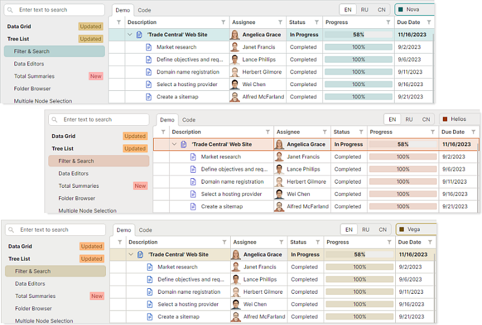
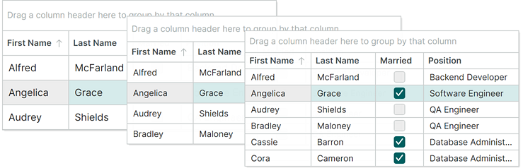
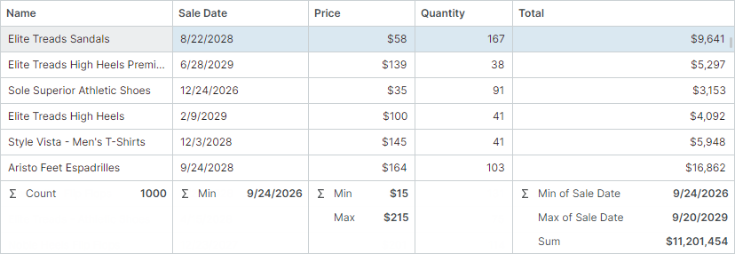
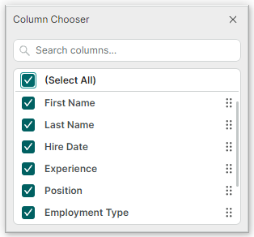
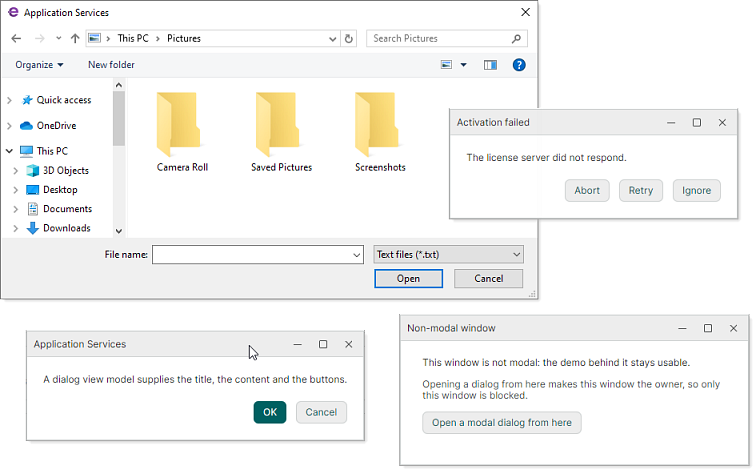
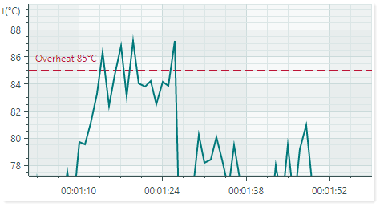
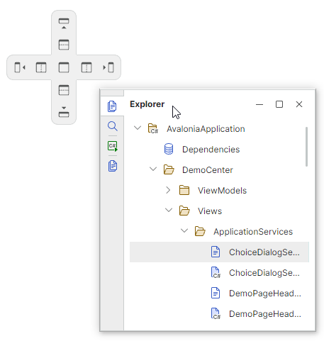
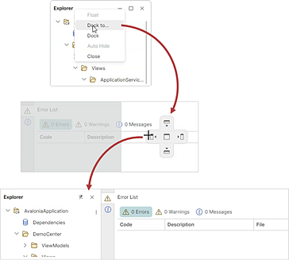
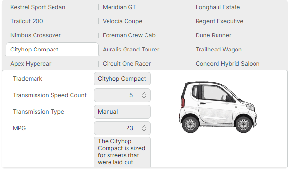
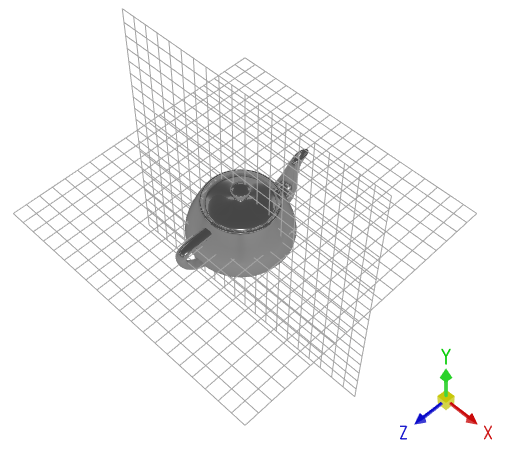

# 版本 1.5 {#version-15}

## 1.5.86 {#1586}

### DeltaDesign 主题的调色板 {#color-palettes-for-deltadesign-theme}

新版本为 DeltaDesign 视觉主题引入了调色板。调色板是应用于基础主题的一组预定义颜色，使用户能够快速切换样式和强调色。



应用调色板会动态更新关键 UI 元素的颜色值，包括：

- 窗口、面板和容器的背景。
- 编辑器在各种状态下的背景。
- 数据感知控件中行和单元格的背景。
- 选择高亮、悬停跟踪元素以及焦点控件的强调色。
- 以及更多。


### DeltaDesign 主题中可自定义的界面密度 {#customizable-ui-density-in-the-deltadesign-theme}

现在，您可以通过调整 `DeltaDesign` 主题中的界面密度，在应用程序中创建更紧凑或更宽松的布局。更改密度会自动缩放元素的内边距和字体大小，以符合您的界面要求。



可用模式：

- `Compact` — 减小内边距和字体大小，以便在屏幕上显示更多信息。

- `Standard`（默认）— 使用均衡的默认间距和排版。

- `Spacious` — 增大内边距和字体大小，使布局更宽松、更易阅读。

文档：[界面密度](../controls/themes/ui-density.md)


### DataGrid 和 TreeList {#datagrid-and-treelist}

#### 总计汇总 {#total-summaries}

DataGrid 和 TreeList 控件现在可以针对其行计算总计汇总，并在控件底部的汇总页脚中显示结果。



- 汇总页脚 — 两个控件都会显示一个汇总页脚，其中显示跨所有行计算的聚合值。
- 内置汇总类型 — Sum、Min、Max、Count 和 Average。
- 每列多个汇总 — 每一列可以显示针对该列值计算的多个汇总。
- 跨列汇总 — 可以针对一列计算汇总，并将结果显示在另一列的页脚单元格中。
- 运行时汇总管理 — 最终用户可以使用内置下拉菜单和 Summary Editor 对话框添加和删除汇总。
- 自定义汇总 — 当内置类型不够用时，可以处理 `CustomSummary` 事件来计算您自己的聚合值。
- 在 XLSX 和 PDF 导出中包含汇总。


#### 行拖放增强 {#row-drag-and-drop-enhancements}

最初，DataGrid 和 TreeList 控件不允许将行放置到空白区域（所有行下方的区域）。从 1.5 版开始，您可以处理 `DragOver` 事件以允许在空白区域上放置行。放置在该区域内的行会追加到所有行的末尾。 

``` cs 
private void ProductsInStockGrid_DragOver(object sender, DataGridDragEventArgs e)
{
    if (e.DropPosition == DropPosition.EmptyArea)
        e.Effects = Avalonia.Input.DragDropEffects.Move;
}
```

您还可以处理 `DragOver` 事件来强制更改放置行时的插入方式。例如，以下 `DragOver` 事件处理程序强制行始终追加到控件的末尾。

``` cs
private void ProductsInStockGrid_DragOver(object sender, DataGridDragEventArgs e)
{
    e.DropPosition = DropPosition.EmptyArea;
    e.Effects = Avalonia.Input.DragDropEffects.Move;
}
```

#### 列选择器中的"Select All" {#select-all-in-column-chooser}

DataGrid 和 TreeList 控件的列选择器（Column Chooser）现在包含 `(Select All)` 命令。

用户现在可以通过一次操作选中或清除所有列，而无需逐个勾选每一列。




#### 应用程序服务 {#application-services}

此版本引入了应用程序服务（Application Services）— 一组与平台无关的服务，用于直接从 ViewModel 处理窗口、对话框和整个应用程序的外观设置，而无需引用任何 Avalonia 窗口类型。



您可以从 ViewModel 代码中调用服务来：

- 打开窗口
- 显示 `Save File` 和 `Open File` 对话框
- 显示消息框和自定义模态对话框
- 识别活动窗口
- 自定义当前 Eremex 视觉主题的设置

这些服务将 ViewModel 与 UI 框架解耦。您通过定义明确的接口访问服务。平台相关的工作（创建窗口、解析所有者、显示对话框等）由服务在内部处理。 

可用的应用程序服务包括：


##### 用户交互服务 {#user-interaction-services}

| 服务 | 说明 |
|---------|---------|
| [`IMessageBoxService`](../API/Eremex.AvaloniaUI.Controls.ApplicationServices/IMessageBoxService.md) | 显示标准消息框，其固定按钮集由 [`MessageBoxButtons`](../API/Eremex.AvaloniaUI.Controls/MessageBoxButtons.md) 枚举定义（Ok、Ok&vert;Cancel、Yes&vert;No&vert;Cancel、Yes&vert;No、Abort&vert;Retry&vert;Ignore 和 Retry&vert;Cancel）。 |
| [`IDialogService`](../API/Eremex.AvaloniaUI.Controls.ApplicationServices/IDialogService.md) | 从 ViewModel 代码中显示对话框，使 ViewModel 无需引用任何窗口类型即可向用户提问。对话框由_对话框 ViewModel_ 驱动。您还可以实现一个 View 作为对话框的内容显示。该 View 通过应用于对话框 ViewModel 的 [`ViewLocatorAttribute`](../API/Eremex.AvaloniaUI.Controls.ApplicationServices/ViewLocatorAttribute.md) 进行定位。 |
| [`IChoiceDialogService`](../API/Eremex.AvaloniaUI.Controls.ApplicationServices/IChoiceDialogService.md) | 显示带有任意按钮集的对话框，并返回所按按钮的结果。 |
| [`IWindowService`](../API/Eremex.AvaloniaUI.Controls.ApplicationServices/IWindowService.md) | 从 ViewModel 代码中显示非模态窗口，使 ViewModel 无需引用任何窗口类型即可打开窗口。模态对话框对应的服务是 [`IDialogService`](../API/Eremex.AvaloniaUI.Controls.ApplicationServices/IDialogService.md)。 |

##### 文件服务 {#file-services}

| 服务 | 说明 |
|---------|---------|
| [`IOpenFileDialogService`](../API/Eremex.AvaloniaUI.Controls.ApplicationServices/IOpenFileDialogService.md) | 以同步或异步模式从 ViewModel 代码中显示平台的 `Open File` 对话框。 |
| [`ISaveFileDialogService`](../API/Eremex.AvaloniaUI.Controls.ApplicationServices/ISaveFileDialogService.md) | 以同步或异步模式从 ViewModel 代码中显示平台的 `Save File` 对话框。 |

##### 基础设施服务 {#infrastructure-services}

| 服务 | 说明 |
|---------|---------|
| [`IWindowsManager`](../API/Eremex.AvaloniaUI.Controls.ApplicationServices/IWindowsManager.md) | 跟踪应用程序的活动窗口。对话框服务使用 [`IWindowsManager`](../API/Eremex.AvaloniaUI.Controls.ApplicationServices/IWindowsManager.md) 服务为新创建的对话框获取默认所有者。 |
| [`IAppearanceService`](../API/Eremex.AvaloniaUI.Controls.ApplicationServices/IAppearanceService.md) | 列出视觉主题设置并应用所选的主题变体。 |

### 图表 {#charts}

#### 使用 LineStyle 进行高级线条自定义 {#advanced-line-customization-with-linestyle}

图表对象现在提供 [`LineStyle`](../API/Eremex.AvaloniaUI.Charts/LineStyle.md) 类型的高级选项，用于自定义线条。[`LineStyle`](../API/Eremex.AvaloniaUI.Charts/LineStyle.md) 公开的属性可让您完全控制线条的呈现方式。 



这些属性包括：

- [`Thickness`](../API/Eremex.AvaloniaUI.Charts/LineStyle/Thickness.md) — 描边粗细。
- [`Dashes`](../API/Eremex.AvaloniaUI.Charts/LineStyle/Dashes.md) — 虚线的虚线样式。
- [`DashOffset`](../API/Eremex.AvaloniaUI.Charts/LineStyle/DashOffset.md) — 虚线样式开始的偏移量。
- [`LineCap`](../API/Eremex.AvaloniaUI.Charts/LineStyle/LineCap.md) — 线条两端使用的形状。
- [`LineJoin`](../API/Eremex.AvaloniaUI.Charts/LineStyle/LineJoin.md) — 两条连续线条端点的连接样式。
- [`MiterLimit`](../API/Eremex.AvaloniaUI.Charts/LineStyle/MiterLimit.md) — 斜接角处连接粗细的限制。

新的线条自定义功能适用于：

- 以下系列视图中的图形线条：所有 Line 和 Area Series View、Lollipop Series View、Range Area Series View、Polar Line 和 Polar Range Area Series View，以及 Smith Line Series View。
- 受支持的系列视图中的常量线（Constant Lines）

    `ConstantLine.Thickness` 属性已弃用。请改用 [`LineStyle.Thickness`](../API/Eremex.AvaloniaUI.Charts/LineStyle/Thickness.md) 选项。

### Docking UI {#docking-ui}

[`DockManager`](../API/Eremex.AvaloniaUI.Controls.Docking/DockManager.md) 组件现在提供了新的 [`CustomizeDockGuide`](../API/Eremex.AvaloniaUI.Controls.Docking/DockManager/CustomizeDockGuide.md) 事件，可在运行时动态隐藏特定的停靠指示及单个指示项。




#### Wayland 支持 {#wayland-support}

Linux 上的原生 Wayland 会话使单个应用程序窗口无法获知或设置自己的屏幕位置。为支持 Wayland 上的停靠操作，面板在上下文菜单中提供 **Dock To** 命令。选择该命令可显示停靠参考线，然后单击参考线将面板停靠到相应位置。

[](../images/docking-wayland-dockto-command.png)

要在 Wayland 上使已停靠的面板浮动，请右键单击面板标题，然后从上下文菜单中选择 **Float**。

已修复的问题：

- 当用户开始拖动浮动组时，该组内的文档面板不会被激活。
- 在 Astra Linux 上无法调整浮动面板的大小。


### MxTabControl {#mxtabcontrol}

此版本新增了多个选项，让您在空间受限时更精细地控制选项卡标题的大小和呈现方式。



- 选项卡拉伸 — 使用新的 `StretchTabsToFill` 属性拉伸选项卡，使其填满整个选项卡条，即使只有少数几个选项卡。
- 选项卡大小 — 新的 [`TabSizeMode`](../API/Eremex.AvaloniaUI.Controls/TabSizeMode.md) 和 `TabSize` 属性控制选项卡的大小。现在可以根据内容调整选项卡大小、与最大的可见选项卡保持一致，或为所有选项卡应用固定宽度。
- 图标显示模式 — 新的 [`TabIconDisplayMode`](../API/Eremex.AvaloniaUI.Controls/TabIconDisplayMode.md) 属性用于控制选项卡图标何时可见（始终、仅在文本折叠时或从不）。

文档：[MxTabControl](../controls/utility-controls/tabcontrol.md)


### Graphics3DControl {#graphics3dcontrol}

[`Graphics3DControl`](../API/Eremex.AvaloniaUI.Controls3D/Graphics3DControl.md) 引入了新成员，用于控制网格平面可见性、鼠标旋转、命中测试和选择。

- 网格平面可见性 — 启用 [`Graphics3DControl.ShowGrid`](../API/Eremex.AvaloniaUI.Controls3D/Graphics3DControl/ShowGrid.md) 属性时，[`Graphics3DControl.GridPlane`](../API/Eremex.AvaloniaUI.Controls3D/Graphics3DControl/GridPlane.md) 属性允许您切换各个网格平面（XY、XZ 和 YZ）的可见性。

    

- 相机旋转模式 — [`Graphics3DControl.RotationMode`](../API/Eremex.AvaloniaUI.Controls3D/Graphics3DControl/RotationMode.md) 属性指定当用户按住鼠标左键拖动以旋转场景时相机环绕的轴心。可用模式包括：

    - `AroundCameraTarget` — 相机围绕其目标（[`Camera.Target`](../API/Eremex.AvaloniaUI.Controls3D/Camera/Target.md)）旋转。
    - `AroundMouseHit` — 相机围绕旋转开始时鼠标指针下方的场景点旋转。当您想在不重新居中相机目标的情况下查看特定元素时，此模式很有用。

    


- 覆盖选择 — 新的 [`Graphics3DControl.SelectionChanging`](../API/Eremex.AvaloniaUI.Controls3D/Graphics3DControl/SelectionChanging.md) 事件允许您响应元素选择并覆盖默认行为。默认情况下，控件会选择单击点下最近的模型和网格。处理 [`SelectionChanging`](../API/Eremex.AvaloniaUI.Controls3D/Graphics3DControl/SelectionChanging.md) 事件以选择其他元素。您可以使用 `HitTestResults` 事件参数获取该点下的所有候选元素。

- 命中测试 — 新的 [`Graphics3DControl.CalcHitInfo`](../API/Eremex.AvaloniaUI.Controls3D/Graphics3DControl/CalcHitInfo.md) 方法允许您确定场景中位于给定点下方的是哪些模型和网格。[`CalcHitInfo`](../API/Eremex.AvaloniaUI.Controls3D/Graphics3DControl/CalcHitInfo.md) 返回所有模型中的所有网格，按从近到远排序。

    有关详细信息，请参阅[命中测试](../controls/graphics3dcontrol/user-interactions-with-3d-models.md#hit-testing)


### 编辑器库 {#editors-library}

SpinEditor 控件现在包含新的 [`AllowRoundOutOfRangeValue`](../API/Eremex.AvaloniaUI.Controls.Editors/SpinEditor/AllowRoundOutOfRangeValue.md) 属性，用于控制用户输入的超出范围的值是否自动舍入到最接近的有效值。可以使用 [`Minimum`](../API/Eremex.AvaloniaUI.Controls.Editors/SpinEditor/Minimum.md) 和 [`Maximum`](../API/Eremex.AvaloniaUI.Controls.Editors/SpinEditor/Maximum.md) 属性限制有效值的范围。

### 工具栏和菜单 {#toolbars-and-menus}

已修复问题：

- 更改 [`ToolbarItem.HotKey`](../API/Eremex.AvaloniaUI.Controls.Bars/ToolbarItem/HotKey.md) 属性时，HotKey 显示文本不会刷新。


### 重大更改 {#breaking-changes}

#### DateEditor 和 SpinEditor - 强制掩码模式 {#dateeditor-and-spineditor-forced-masked-mode}

- [`DateEditor`](../API/Eremex.AvaloniaUI.Controls.Editors/DateEditor.md) 和 [`SpinEditor`](../API/Eremex.AvaloniaUI.Controls.Editors/SpinEditor.md) 现在始终在掩码模式下工作，分别为 [`MaskType.DateTime`](../API/Eremex.AvaloniaUI.Controls.Editors/MaskType.md) 和 [`MaskType.Numeric`](../API/Eremex.AvaloniaUI.Controls.Editors/MaskType.md)。无法再为这些编辑器禁用掩码模式（[`MaskType.None`](../API/Eremex.AvaloniaUI.Controls.Editors/MaskType.md)）或启用不兼容的掩码模式。

#### Docking UI — 过时的属性 {#docking-ui-obsolete-property}

`ShowAutoHideExpandButton` 属性现已过时。该属性在之前的版本中并不受支持，现已被弃用。

<br>
<br>

<sup>*</sup> 本页面使用机器翻译技术翻译。
