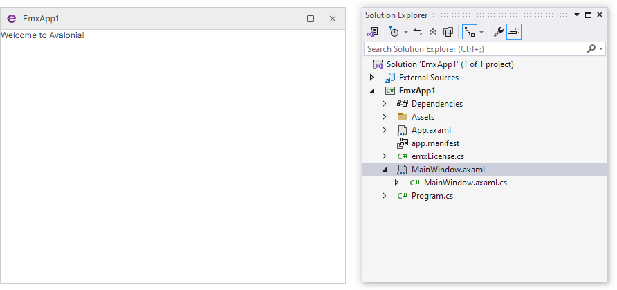
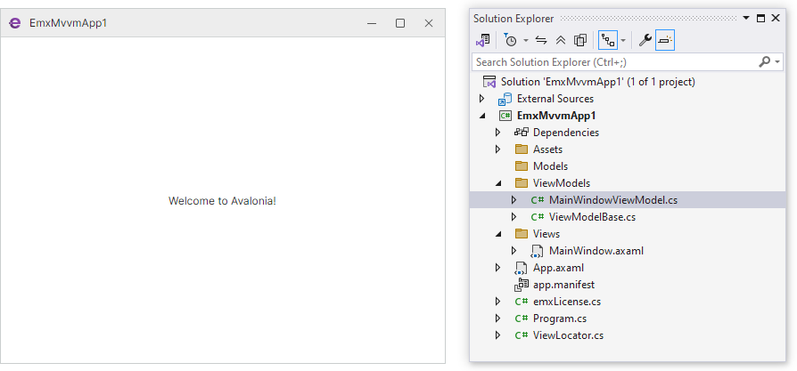
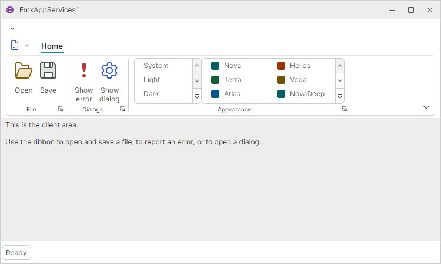
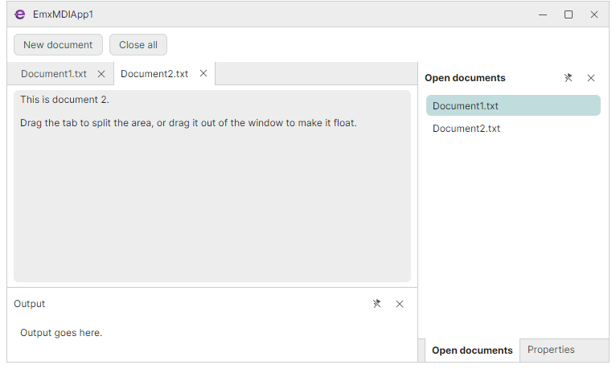
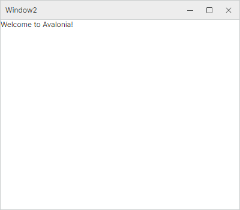

# 项目模板和项目项模板 {#project-and-project-item-templates}

**Eremex.Avalonia.Templates** [NuGet 包](https://www.nuget.org/profiles/EremexControls)包含的模板可帮助您快速创建使用 Eremex Controls 库的新 Avalonia UI 项目，并向现有项目中添加基于 Eremex 的窗口。

## 安装 Eremex Avalonia 模板 {#install-the-eremex-avalonia-templates}

运行以下命令：

<code>
dotnet new install Eremex.Avalonia.Templates
</code>

## 更新 Eremex Avalonia 模板 {#update-the-eremex-avalonia-templates}

要更新到最新版本，请运行模板安装命令：

<code>
dotnet new install Eremex.Avalonia.Templates
</code>

## 包含的项目模板 {#included-project-templates}

下列所有项目模板都会向创建的项目添加所需的 Eremex NuGet 包，使主窗口派生自 [`MxWindow`](../API/Eremex.AvaloniaUI.Controls.Common/MxWindow.md) 以支持主题，并注册 `DeltaDesign` 绘制主题。

### Eremex Avalonia .NET App {#eremex-avalonia-net-app}

带有 Eremex NuGet 包的空桌面应用程序。

**短名称**：`emx.app`

**创建项目命令**：<code>
dotnet new emx.app -n AvaloniaApplication1 
</code>

### Eremex Avalonia .NET MVVM App {#eremex-avalonia-net-mvvm-app}

基于 MVVM 的空应用程序，将 UI 和业务逻辑分离到 View 层和 ViewModel 层。 

**短名称**：`emx.mvvm`

**创建项目命令**：<code>
dotnet new emx.mvvm -n AvaloniaApplication1 
</code>

此应用程序模板会创建一个支持 MVVM 并引用 Eremex Controls 库的 Avalonia UI 项目。该模板将代码分离到 View（_MainWindow_）层和 ViewModel（_MainWindowViewModel_）层。

### Eremex Avalonia .NET App with Application Services {#eremex-avalonia-net-app-with-application-services}

一个 MVVM 应用程序，ViewModel 通过服务访问对话框、文件选择器和视觉主题管理功能。

**短名称**：`emx.services`

**创建项目命令**：<code>
dotnet new emx.services -n AvaloniaApplication1 
</code>

此模板会创建一个 MVVM 应用程序，通过注入到 ViewModel 中的 Eremex 服务实现以下功能：

- 调用打开/保存文件对话框
- 显示自定义对话框
- 显示消息框
- 在 Ribbon 界面中提供主题选择器

### Eremex Avalonia .NET MDI App {#eremex-avalonia-net-mdi-app}

基于 Docking 库构建、采用选项卡式多文档（MDI）布局的应用程序。

**短名称**：`emx.mdi`

**创建项目命令**：<code>
dotnet new emx.mdi -n AvaloniaApplication1 
</code>

此模板会创建一个使用 [`DockManager`](../API/Eremex.AvaloniaUI.Controls.Docking/DockManager.md) 组件的 MVVM 应用程序，用于实现：

- 选项卡式多文档界面（MDI）
- 从 ViewModel 创建和关闭文档

## 包含的项目项模板 {#included-project-item-templates}

### Eremex Avalonia Window {#eremex-avalonia-window}

一个空的 [`MxWindow`](../API/Eremex.AvaloniaUI.Controls.Common/MxWindow.md)（支持 Eremex 视觉主题的窗口）。

**短名称**：`emx.window`

**创建项目项命令**：<code>
dotnet new emx.window -n Window2 
</code>

此项目项模板会创建一个基于 [`MxWindow`](../API/Eremex.AvaloniaUI.Controls.Common/MxWindow.md) 的新 Avalonia 窗口。该模板仅创建定义窗口的两个文件：_Window.axaml_ 和 _Window.axaml.cs_。

 
 

* 本页面使用机器翻译技术翻译。
